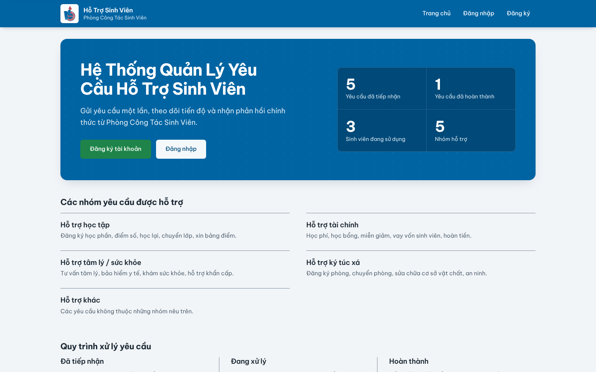
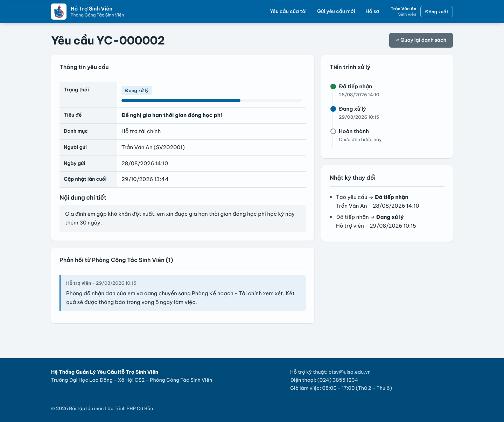
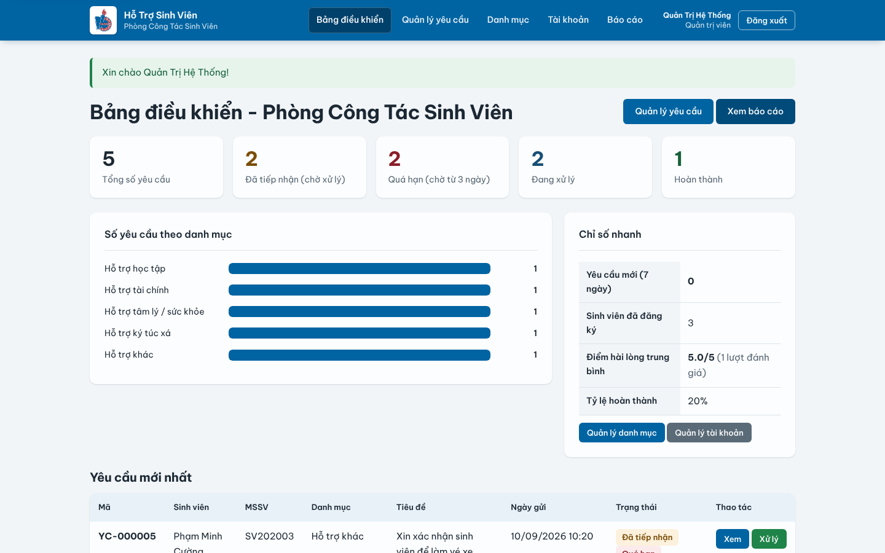
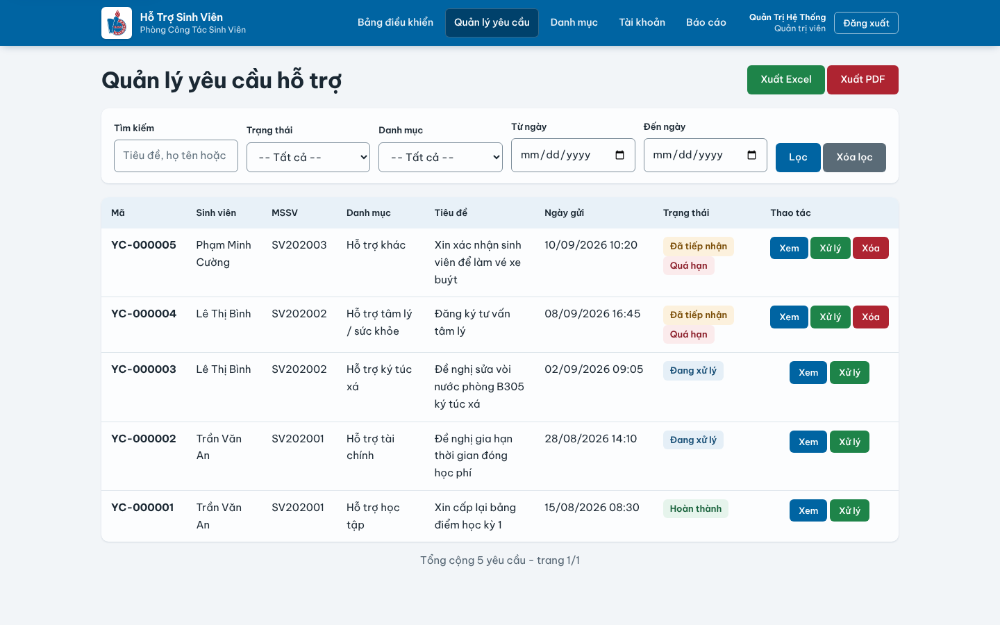
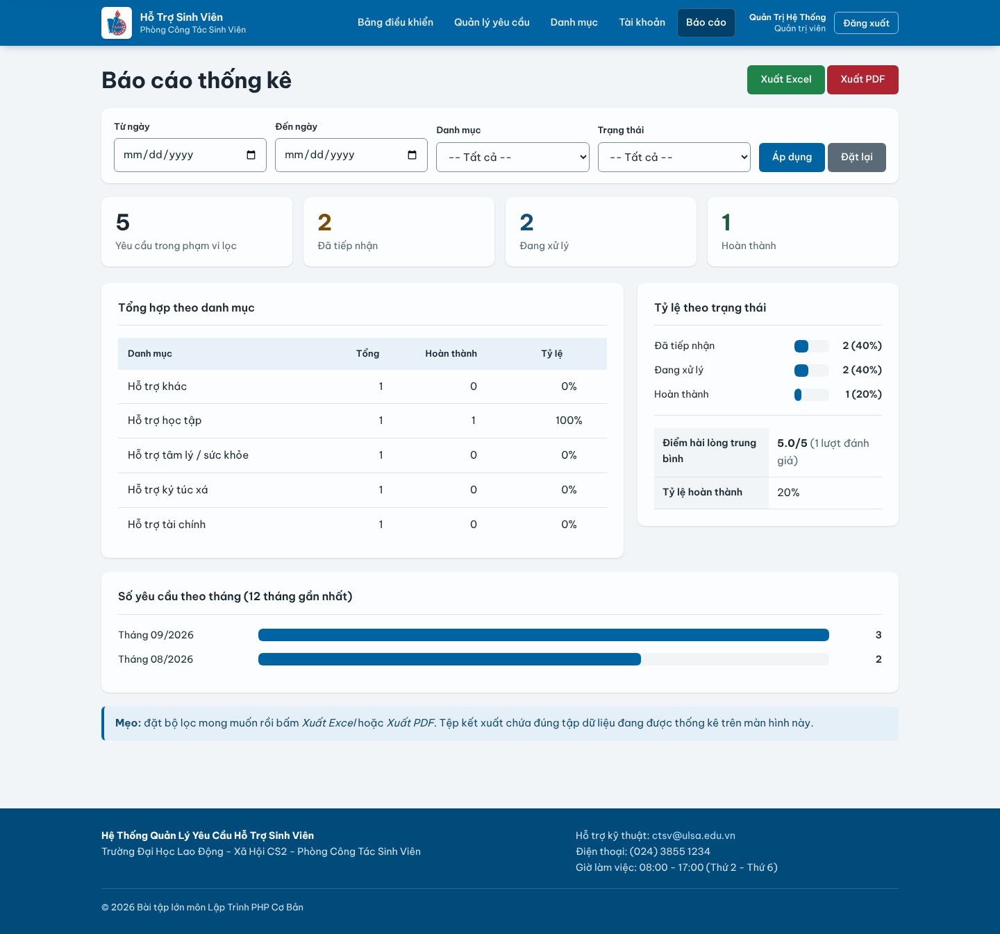

# Student Support Request System

**English** · [Tiếng Việt](#tiếng-việt)

A web application where students submit support requests (academic, financial, dormitory, health…) and follow their progress, while the Student Affairs Office receives, processes, replies to and reports on every request. Plain PHP 8 + MySQL, no framework.

Course project for PHP Programming at the University of Labour and Social Affairs (Campus II), topic 63. Built by **An Nguyen Huu (Aaron Nguyen)** (requirements, database design, UI, code, security hardening, testing).

## Try it in 1 click

1. Click **Open in GitHub Codespaces** above (free with any GitHub account).
2. Wait 1–2 minutes while the PHP + MariaDB containers start and the sample database loads.
3. The app opens in a new tab (port 80). If it does not, open the **Ports** tab and click the globe icon.

Or on your own machine with Docker: `docker compose up` then open <http://localhost:8080>.

| Role | Email | Password | Login page |
|---|---|---|---|
| Admin | `admin@system.com` | `Admin@123` | `/admin/login.php` |
| Support staff | `staff@system.com` | `Staff@123` | `/admin/login.php` |
| Student | `an.tran@sv.ulsa.edu.vn` | `Sinhvien@123` | `/user/login.php` |

E-mails are written to `logs/email.log` in demo mode instead of being sent.

## Features

**Students:** register, log in, edit profile, submit requests with attachments (PDF/DOC/images ≤ 5 MB), filter and search their own requests, follow a status timeline (Received → In progress → Done), read staff replies, rate the result 1–5 stars, get automatic e-mails.

**Staff / admin:** dashboard with KPIs and overdue warnings, request management with filters and pagination, status changes with replies and attachments, category management, staff accounts (admin only), reports by status / category / month and satisfaction score, export to Excel (.csv) and PDF.

## Security

| Risk | Mitigation |
|---|---|
| SQL injection | Every query goes through prepared statements (`db_query()`) |
| XSS | All output escaped with `htmlspecialchars` (`e()`); strict Content-Security-Policy |
| CSRF | 64-char token on every POST form, compared with `hash_equals()` |
| Passwords | `password_hash` (bcrypt); account locked for 5 minutes after 5 failed logins |
| Sessions | ID regenerated after login, `HttpOnly` + `SameSite=Lax` cookies, idle timeout |
| Access control | Role checks on every page; students only see rows with their own `user_id` |
| File upload | Size + extension whitelist + real MIME check, random file names, PHP execution blocked in `uploads/` |
| Data integrity | Request processing runs in a transaction with rollback |

## Tech stack

PHP 8 (procedural) · MySQL / MariaDB (InnoDB, utf8mb4, 5 tables with foreign keys) · HTML5, hand-written CSS (responsive, dark mode), vanilla JavaScript · PHPMailer · Docker + GitHub Actions (syntax check and smoke test on every push).

## Screenshots

| Student – request detail | Admin – dashboard |
|---|---|
|  |  |
| **Admin – request list** | **Admin – reports** |
|  |  |

## Run with XAMPP

See [INSTALL.md](INSTALL.md) (Vietnamese): copy the folder into `htdocs`, import `sql/db.sql`, open `http://localhost/<folder>`. Test cases are in [TEST_CASES.md](TEST_CASES.md).

Developed with help from Claude (AI assistant); all decisions, testing and review were done by the author.

---

## Tiếng Việt

Ứng dụng web giúp sinh viên gửi yêu cầu hỗ trợ trực tuyến và theo dõi tiến độ xử lý; Phòng Công tác Sinh viên tiếp nhận, phản hồi và thống kê toàn bộ yêu cầu. PHP 8 thuần + MySQL, không dùng framework.

Bài tập lớn môn Lập trình PHP, Trường Đại học Lao động – Xã hội (CS II), đề tài 63. Người thực hiện: **Nguyễn Hữu An**.

### Chạy thử

- **Không cần cài gì**: bấm nút **Open in GitHub Codespaces** ở đầu trang, chờ 1–2 phút, ứng dụng tự mở ở tab mới.
- **Có Docker**: `docker compose up` rồi mở <http://localhost:8080>.
- **XAMPP**: làm theo [INSTALL.md](INSTALL.md).

Tài khoản mẫu: `admin@system.com` / `Admin@123`, `staff@system.com` / `Staff@123`, sinh viên `an.tran@sv.ulsa.edu.vn` / `Sinhvien@123`.

Dự án có sự hỗ trợ của Claude (trợ lý AI); mọi quyết định, kiểm thử và rà soát do tác giả thực hiện.
